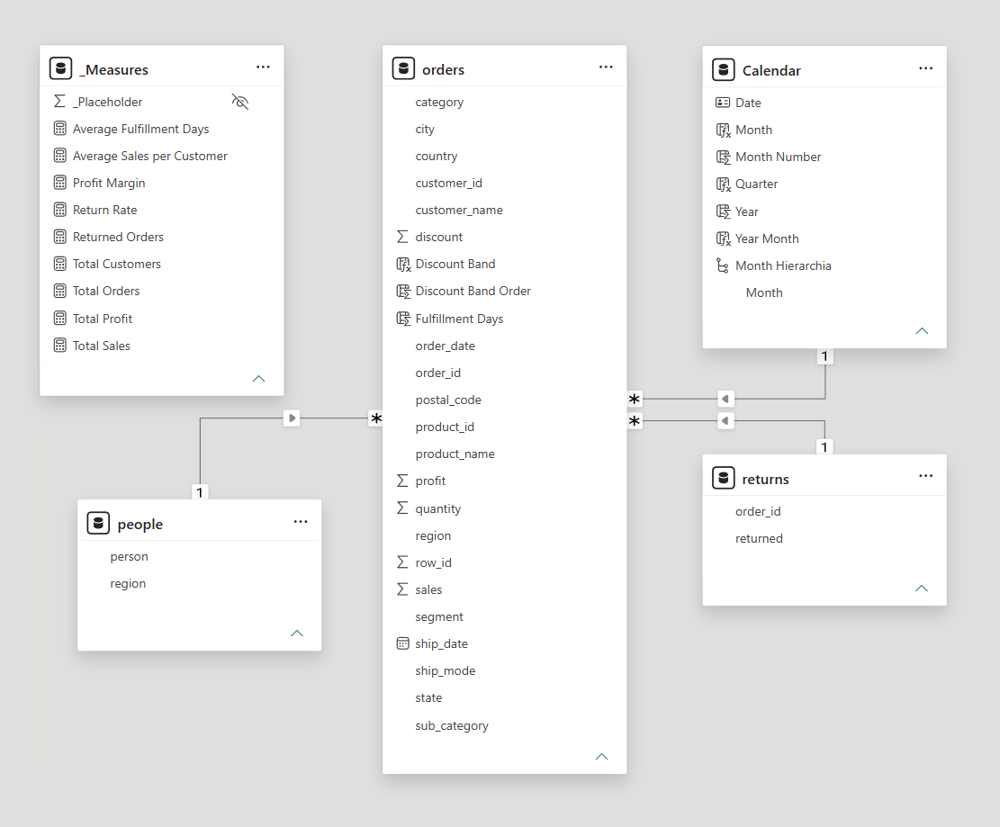
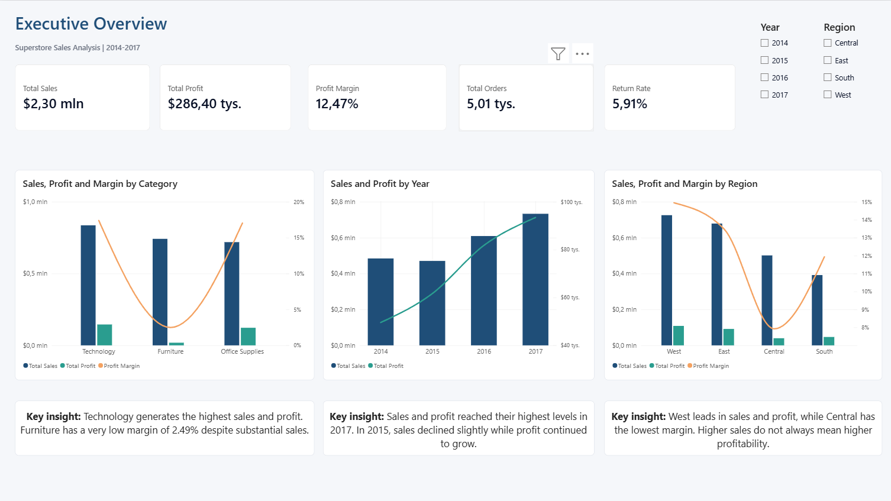
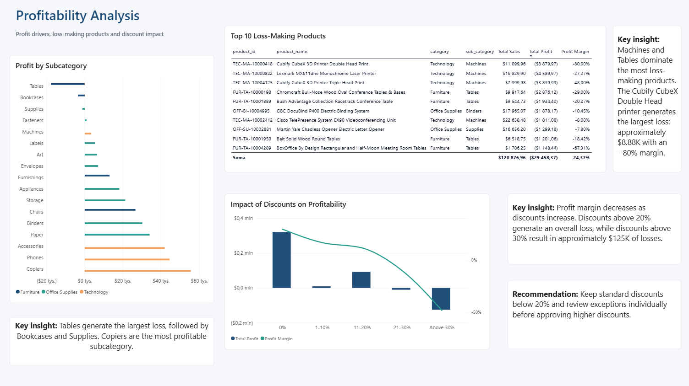
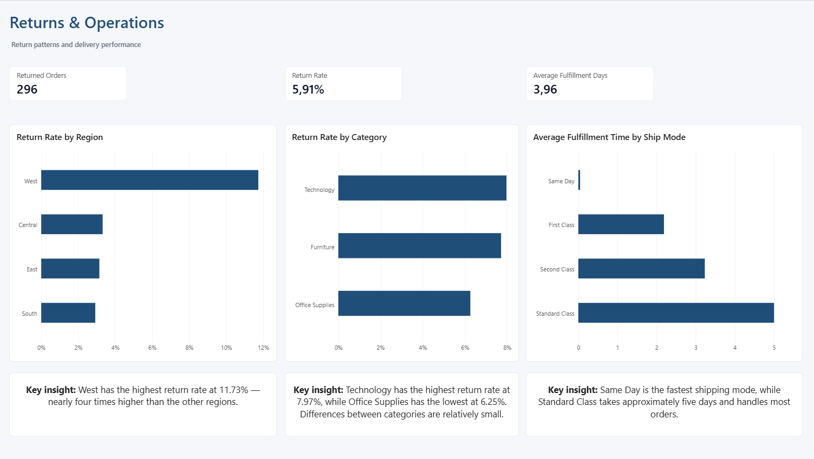
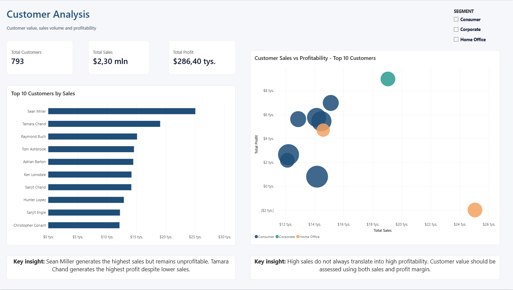
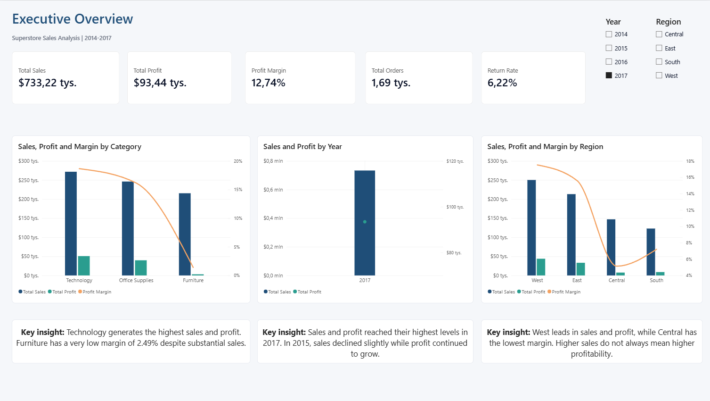
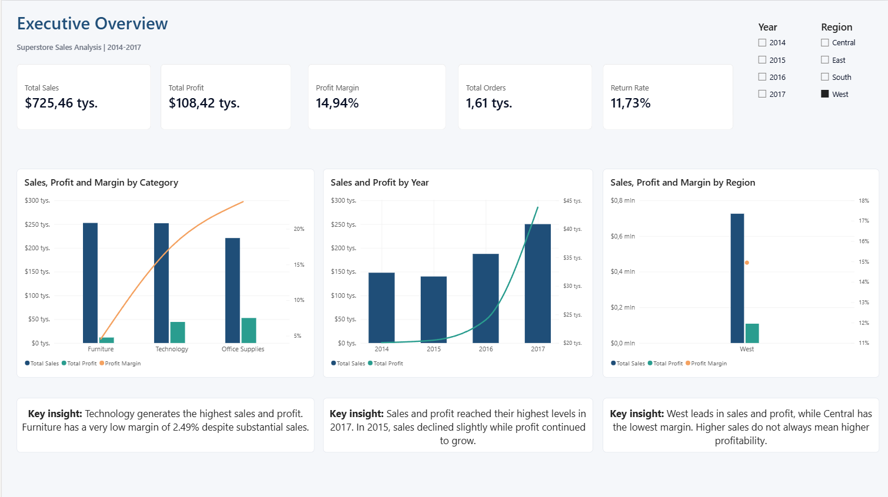
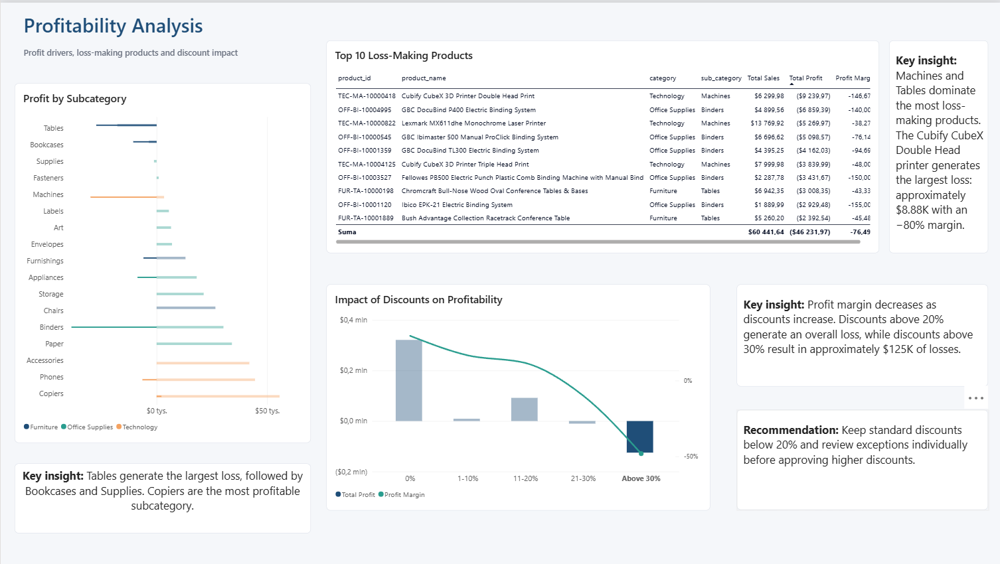
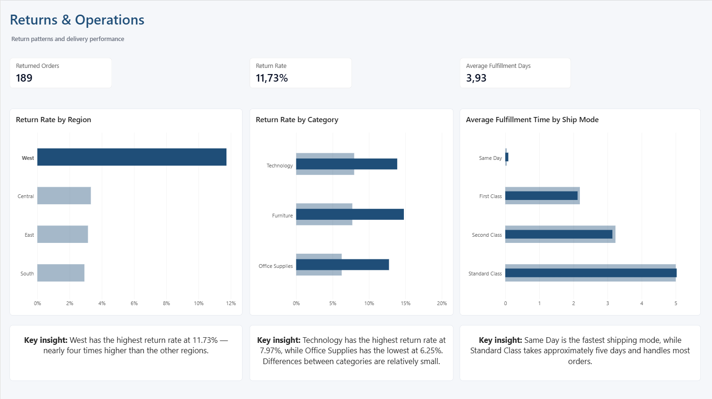
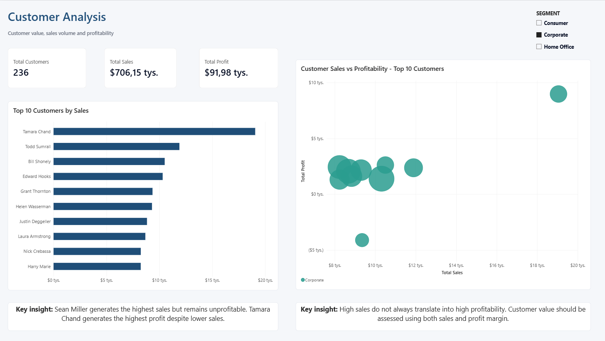

# Superstore Sales Analysis

## Project Overview

This project presents an end-to-end analysis of the Sample Superstore dataset using MySQL, SQL, Power BI, Power Query and DAX.

The analysis covers sales performance, profitability, discounts, product losses, customer value, returns and order fulfillment. The final result is an interactive four-page Power BI dashboard supported by SQL data preparation, quality checks and business analysis.

## Business Objective

The main objective was to identify:

- the main sources of sales and profit,
- unprofitable categories, subcategories and products,
- the impact of discounts on profitability,
- regions and categories with high return rates,
- the most valuable customers,
- differences in order fulfillment time between shipping methods.

The analysis was also used to prepare practical recommendations for improving profitability and operational performance.

## Business Questions

1. How did sales and profit change over time?
2. Which regions and product categories were the most profitable?
3. Which subcategories and products generated losses?
4. How did discounts affect profit and margin?
5. Where did the highest return rates occur?
6. Which customers generated the highest sales and profit?
7. How long did order fulfillment take for each shipping method?
8. Does high sales volume always indicate high profitability?

## Dataset

The project uses the Sample Superstore dataset containing three source tables:

- `Orders` — order-line data,
- `Returns` — returned orders,
- `People` — regional managers.

### Dataset Summary

| Metric | Value |
|---|---:|
| Order lines | 9,994 |
| Unique orders | 5,009 |
| Customers | 793 |
| Returned orders | 296 |
| Analysis period | 2014–2017 |

The `Orders` table is stored at order-line level, while the `Returns` table is stored at order level. Therefore, order-related metrics use `COUNT(DISTINCT order_id)`.

## Tools and Technologies

- MySQL
- DBeaver
- SQL
- Power BI
- Power Query
- DAX
- Microsoft Excel

## Project Workflow

### 1. Data Import

The source Excel workbook contains three worksheets: Orders, Returns and People. Each worksheet was exported to a separate CSV file and imported into a raw MySQL table using DBeaver:

- `raw_orders`
- `raw_returns`
- `raw_people`

### 2. Data Preparation

The preparation process included:

- converting text dates to the `DATE` data type,
- converting sales, discounts and profit to decimal values,
- trimming text fields,
- creating cleaned `orders`, `returns` and `people` tables,
- assigning primary keys where appropriate.

### 3. Data Quality Checks

The SQL quality checks included:

- row-count validation,
- missing-value checks,
- numeric-format validation,
- date-conversion checks,
- invalid shipping-date detection,
- duplicate and key validation,
- verification of relationships between the tables,
- checking consistency within individual orders,
- confirming the grain of each table.

### 4. SQL Business Analysis

SQL was used to analyze:

- yearly sales, profit and margin,
- profitability by region and category,
- loss-making subcategories and products,
- discount bands and profitability,
- return rates by category and region,
- customer sales and profitability,
- fulfillment time by shipping method.

### 5. Power BI Dashboard

The cleaned tables were loaded into Power BI and connected with a dedicated Calendar table.

The main relationships were:

- `Calendar` → `orders` using order date,
- `people` → `orders` using region,
- `returns` → `orders` using order ID.

#### Power BI Data Model

The model uses `orders` as the central fact table. The `Calendar`, `returns` and `people` tables provide date, return and regional context for the analysis.

The relationships use one-to-many cardinality and single-direction filtering to keep the model clear and predictable.



### 6. DAX Measures

The report uses measures including:

- Total Sales
- Total Profit
- Profit Margin
- Total Orders
- Returned Orders
- Return Rate
- Average Fulfillment Days
- Total Customers
- Average Sales per Customer

## Dashboard Pages

### Executive Overview

The overview presents the main KPIs and compares sales, profit and margin across years, regions and product categories.



### Profitability Analysis

This page identifies unprofitable subcategories and products and shows how increasing discounts affect profit and margin.



### Returns & Operations

This page compares return rates across regions and categories and presents fulfillment time by shipping method.



### Customer Analysis

This page presents the highest-value customers and compares customer sales with profitability.



## Interactive Features

The dashboard includes interactive filters and cross-filtering between visuals.

### Analysis Filtered to 2017



### Analysis Filtered to the West Region



### Transactions with Discounts Above 30%



### Returns in the West Region



### Corporate Customer Segment



## Key Results

| Metric | Result |
|---|---:|
| Total Sales | $2.30M |
| Total Profit | $286.40K |
| Profit Margin | 12.47% |
| Return Rate | 5.91% |
| Average Fulfillment Time | 3.96 days |

## Key Findings

- Sales and profit reached their highest levels in 2017. Profit increased every year, while sales recorded a slight decline in 2015 followed by strong growth.
- Central generated higher sales than South, but South achieved higher profit and margin. Sales volume alone is therefore not a sufficient measure of profitability.
- Furniture generated substantial sales but retained only a small share as profit. Its margin was approximately 2.49%.
- Tables, Bookcases and Supplies were the only subcategories with negative total profit.
- Machines remained profitable as a complete subcategory, but several individual products generated significant losses.
- Tables and Machines dominated the list of the ten most loss-making products.
- Discounts above 20% generated an overall loss. Discounts above 30% resulted in approximately $125K in losses and a margin of approximately −48%.
- Technology had the highest category return rate at 7.97%, while Office Supplies had the lowest at 6.25%. The differences between categories were relatively small.
- West had a return rate of 11.73%, almost four times higher than the other regions.
- Same Day shipping took an average of 0.05 days. Because the maximum was one day, approximately 95% of these orders were shipped on the same day.
- Standard Class handled 2,994 of 5,009 orders and took an average of five days, making it the most operationally important shipping method.
- Sean Miller generated the highest sales but produced approximately $1.98K in losses with a −7.91% margin.
- Tamara Chand generated approximately $8.98K in profit despite lower sales, demonstrating that high sales do not always indicate high customer value.

## Business Recommendations

1. Keep standard discounts below 20%.
2. Require additional approval and profitability checks for discounts between 21% and 30%.
3. Avoid discounts above 30%, as they generate substantial losses.
4. Review pricing, discounting and product costs for Tables, Bookcases and Supplies.
5. Investigate the most loss-making products within Machines and Tables instead of evaluating subcategories only at aggregate level.
6. Investigate the high return rate in the West region by comparing product mix, discounts, shipping methods and customer behavior with other regions.
7. Evaluate customer value using profit and margin in addition to sales volume and order count.
8. Prioritize operational monitoring of Standard Class because it handles approximately 60% of all orders.

## Repository Structure

```text
superstore-sales-analysis/
├── README.md
├── data/
│   └── Sample-Superstore.xls
├── images/
│   ├── dashboards/
│   │   ├── 01_executive_overview.png
│   │   ├── 02_profitability_analysis.png
│   │   ├── 03_returns_operations.png
│   │   └── 04_customer_analysis.png
│   ├── interactions/
│   │   ├── 05_executive_overview_2017.png
│   │   ├── 06_executive_overview_west.png
│   │   ├── 07_profitability_high_discounts.png
│   │   ├── 08_returns_west_region.png
│   │   └── 09_customers_corporate.png
│   └── model/
│       └── 10_power_bi_data_model.png
├── power-bi/
│   ├── Superstore_Sales_Analysis.pbix
│   └── Superstore_Sales_Analysis.pdf
└── sql/
    ├── 01_database_and_raw_tables.sql
    ├── 02_data_preparation_and_quality.sql
    └── 03_business_analysis.sql
```

## How to Run the Project

### SQL

1. Open MySQL and connect through DBeaver.
2. Run `01_database_and_raw_tables.sql`.
3. Export the Orders, Returns and People worksheets from the source workbook to separate CSV files.
4. Import the CSV files into `raw_orders`, `raw_returns` and `raw_people`.
5. Run `02_data_preparation_and_quality.sql`.
6. Run `03_business_analysis.sql`.

The SQL scripts are intended to be executed in order.

### Power BI

1. Open `Superstore_Sales_Analysis.pbix` in Power BI Desktop.
2. If necessary, update the MySQL connection in the data-source settings.
3. Refresh the data.
4. Use the available year, region and customer-segment filters to explore the dashboard.

A static version of the report is available in `power-bi/Superstore_Sales_Analysis.pdf`.

## Author

Created as a data analytics portfolio project using SQL and Power BI.
